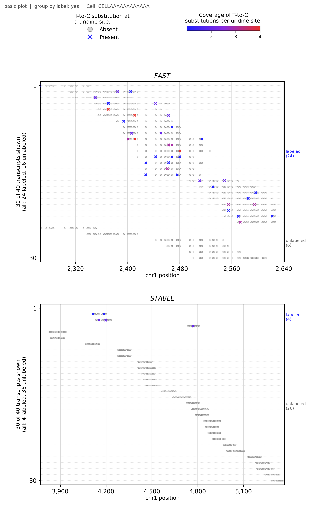
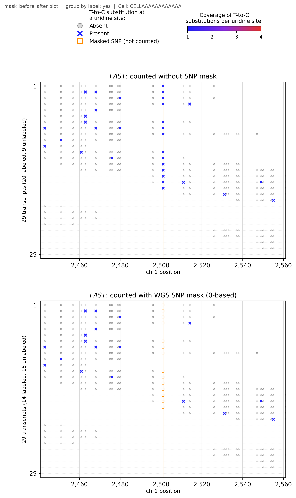
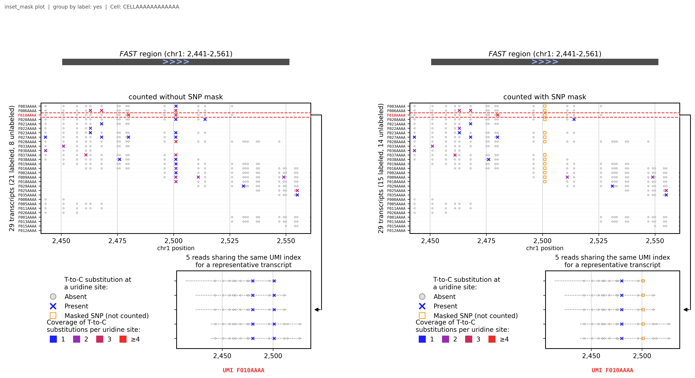
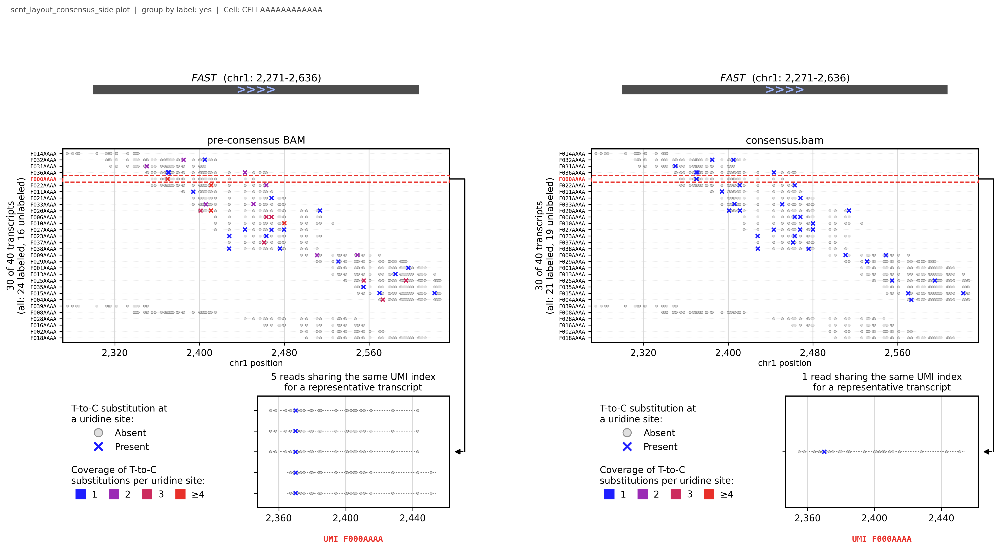

# T>C calling with donor SNP masking (scNT-seq, dynast)

Scripts to mask donor WGS SNPs (T>C / A>G) in dynast T>C counting, check the mask, and plot single transcripts of single cells.

## Examples (simulated data)

`examples/run_examples.sh` builds a small **simulated** dataset (`examples/make_demo_data.py`:
two genes, two cells, one homozygous T>C SNP; no real data) and makes one figure of each
plot type in `examples/figures/`:

```bash
bash examples/run_examples.sh
```

| Figure | Command (main options of `scripts/plot_tc_panel.py`) |
|---|---|
| 1 fast vs stable gene, same cell | `--genes FAST STABLE` |
| 2 every read in its row | `--genes FAST --reads-in-rows` |
| 3 mask: no mask \| corrected mask | `--bam consensus.bam --min-bq 28 --genes FAST --before-after` |
| 4 scNT-seq layout | `--genes FAST --scnt-layout --label-umis` |
| 5 scNT-seq layout, no mask \| mask | `--genes FAST --scnt-layout --compare-layout mask` |
| 6 scNT-seq layout, pre-consensus \| consensus | `--genes FAST --scnt-layout --compare-consensus consensus.bam --compare-layout side` |
| 7 transcripts, pre-consensus \| consensus | `--genes FAST --compare-consensus consensus.bam --compare-panels masked` |

**1. Fast vs stable gene in one cell** — each row a transcript; X = T>C, colour = reads carrying it;
labeled transcripts above the dashed line.



**3. What the SNP mask removes** — the SNP is a column of X's without the mask (top) and orange
squares (not counted) with the mask (bottom); real conversions stay.



**5. scNT-seq layout, no mask | mask** — the highlighted transcript's reads (inset) all carry the SNP.



**6. scNT-seq layout, pre-consensus | consensus.bam** — several reads per transcript (left) become one
consensus read (right); a T>C seen in one read only is outvoted.



All figures: [examples/figures](examples/figures).

## How to run

All scripts are in `scripts/`. Run them from your working folder (examples assume
`scripts/` is a sub-folder of it). Every script prints `--help`.

## 0. Setup

```bash
conda activate <env with dynast, bcftools, samtools, pysam, anndata, matplotlib>

# set once per terminal (adapt the paths)
fa=/path/to/reference/GRCh38.genome.fa                 # with .fai
gtf=/path/to/reference/gencode.annotation.gtf
bam=/path/to/split_bams/DONOR.bam                       # pre-consensus BAM (indexed), input of dynast consensus
cons=/path/to/split_bam_consensus/DONOR/consensus.bam   # output of dynast consensus (indexed)
mask=/path/to/WGS_SNP_mask_0-based/DONOR_snps.csv       # made in step 1
```

Inputs needed: per-donor WGS VCFs, genome FASTA + GTF (same as used for alignment),
the donor BAM before consensus and dynast `consensus.bam`.

---

## 1. Build the SNP mask — `make_snp_mask.sh`

Keeps SNPs the donor carries (GT alt) that are genomic T>C or A>G, writes **0-based**
positions (VCF POS − 1) with the header `contig,genome_i,conversion` (what dynast expects).

```bash
vcf_dir=/path/to/wgs_vcfs ref_fa=$fa out_dir=/path/to/WGS_SNP_mask_0-based \
    bash scripts/make_snp_mask.sh
```

Output: `<donor>_snps.csv` per donor and `snps_union_all.csv` (all donors).
Expect ~1.3–1.7 million sites per donor. Count sites and genome %:

```bash
bash scripts/count_mask_sites.sh /path/to/WGS_SNP_mask_0-based $fa
```

## 2. Count T>C with dynast, with the mask

Batch (edit the sample list and paths at the top of the script first):

```bash
bash scripts/run_dynast_bg_correction.sh
```

Per sample it runs `dynast count` on `consensus.bam` twice — `TC/` (no mask) and
`TC_rm_bg/` (`--snp-csv` union mask) — and then `check_snp_mask.py`.

One-donor test (copies inputs, builds/uses masks, runs dynast 3×, checks, plots):

```bash
donor=DONOR sample=SAMPLE base=/path/to/TC_mask_test bash scripts/run_TC_mask_test.sh
```

## 3. Check the mask — `check_snp_mask.py`

```bash
python scripts/check_snp_mask.py --mask $mask --fasta $fa --bam $cons \
    --conversions <run>/TC/conversions.csv --unmasked <run>/TC --masked <run>/TC_rm_bg
```

| Check | Pass means |
|---|---|
| FORMAT | header `contig,genome_i,conversion`, TC/AG only, contigs match the BAM |
| COORDINATE | reference base at `genome_i` is T (TC) / A (AG) in ~100% → file is 0-based |
| DYNAST | T>C in the unmasked run fall exactly on mask positions, not ±1 bp |
| EFFECT | per-cell T>C rate drops with the mask |

Compare per-cell T>C rates of several runs:

```bash
python scripts/plot_mask_effect.py --run "No mask=<run>/TC" --run "Mask=<run>/TC_rm_bg" --out mask_effect.pdf
```

## 4. Plot single transcripts — `plot_tc_panel.py`

Each row = one transcript (UMI) of one cell; grey circle = covered uridine,
X = T>C (colour = reads of that transcript carrying it); masked SNPs are not counted.

```bash
common="--fasta $fa --gtf $gtf --snp-csv $mask --outdir plots"
```

| Plot | Command (add `$common`) |
|---|---|
| Transcripts of genes in one cell | `--bam $bam --genes SOX2 ACTB` |
| … with every read in its row | `... --reads-in-rows` |
| Mask: no mask \| corrected mask | `--bam $cons --min-bq 28 --genes GSTP1 --before-after` |
| scNT-seq layout (rows + reads of one transcript) | `--bam $bam --genes SOX2 --scnt-layout --label-umis` |
| scNT-seq layout, no mask \| mask | `--bam $bam --genes GSTP1 --scnt-layout --compare-layout mask` |
| scNT-seq layout, pre-consensus \| consensus | `--bam $bam --genes SOX2 --scnt-layout --compare-consensus $cons --compare-layout side` |
| Transcripts, pre-consensus \| consensus | `--bam $bam --genes SOX2 --compare-consensus $cons --compare-panels masked` |

Example:

```bash
python scripts/plot_tc_panel.py --bam $bam $common --genes SOX2 ACTB --vmax 4 --max-umis 100000
```

### Choosing genes

| Way | Options |
|---|---|
| Your genes | `--genes A B` |
| By NTR (labeled / all UMIs) | `--adata <masked run>/adata.h5ad --high-ntr-genes 1 --low-ntr-genes 1` (look first: `--list-genes 20`) |
| By mask effect | `--adata <masked>/adata.h5ad --adata-unmasked <unmasked>/adata.h5ad --mask-genes 2` (look first: `--list-mask-genes 20`) |

Useful filters: `--min-gene-umis`, `--no-mt-ribo`, `--high-ntr-percentile 90`, `--low-ntr-percentile 10`,
`--min-removed-pct 20`, `--mask-rank-by removed|pct|umis|ntr`.
Suggested NTR defaults for your data: `python scripts/ntr_defaults_check.py --adata <masked>/adata.h5ad`.

### Choosing cells

Best cell automatically · `--cell BARCODE` · `--top-cells N` (one file per cell) ·
`--list-cells 5` (print only).

### Layout options

| Option | Effect |
|---|---|
| `--group-by-label yes/no` | labeled on top with divider / one diagonal by position |
| `--max-umis N` | rows per panel (`100000` = all) |
| `--vmax 4` | colour scale 1–4 |
| `--window N`, `--xlim A B`, `--utr3` | genomic window |
| `--label-umis`, `--highlight-umis U` | UMI names / highlight a transcript |
| `--format pdf/png/svg` | file type |

Output names: `<plot>_group-<yes|no>_mask-<yes|no>_<genes>_<cell>.pdf`.
Which BAM: `$bam` for read-level views and coverage colours; `$cons --min-bq 28` for what dynast counted.

## 5. Inspect the consensus step

One molecule — its reads, the quality-weighted vote and the consensus record:

```bash
python scripts/explain_consensus.py --bam $bam --consensus $cons --fasta $fa --gtf $gtf \
    --gene SOX2 [--cell CB --umi UB] --out explain.pdf
```

All molecules of some genes — fraction of T>C kept by consensus vs reads covering:

```bash
python scripts/validate_consensus.py --bam $bam --consensus $cons --fasta $fa --gtf $gtf \
    --genes SOX2 ACTB GAPDH --out validate.pdf --table validate.tsv
```

## 6. Batch helpers

| Script | Does |
|---|---|
| `plot_top_cells.sh` | top N cells per gene: pre vs consensus + scNT-seq layout figures |
| `plot_mask_examples.sh` | mask figures for a list of genes + `summary.tsv` |
| `make_doc_examples.sh 1\|2` | example PDFs for transcript / mask plots |

Settings are passed as variables in front, e.g. `n=3 bam=$bam cons=$cons mask=$mask bash scripts/plot_top_cells.sh SOX2 ACTB`.

Other helpers: `find_snp_examples.py`, `find_mask_genes.py`, `find_mask_examples.py`,
`rank_turnover_genes.py`, `find_panel_examples.py` (each: `--help`).
